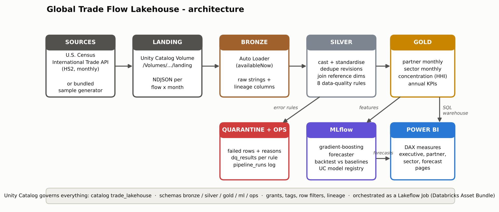
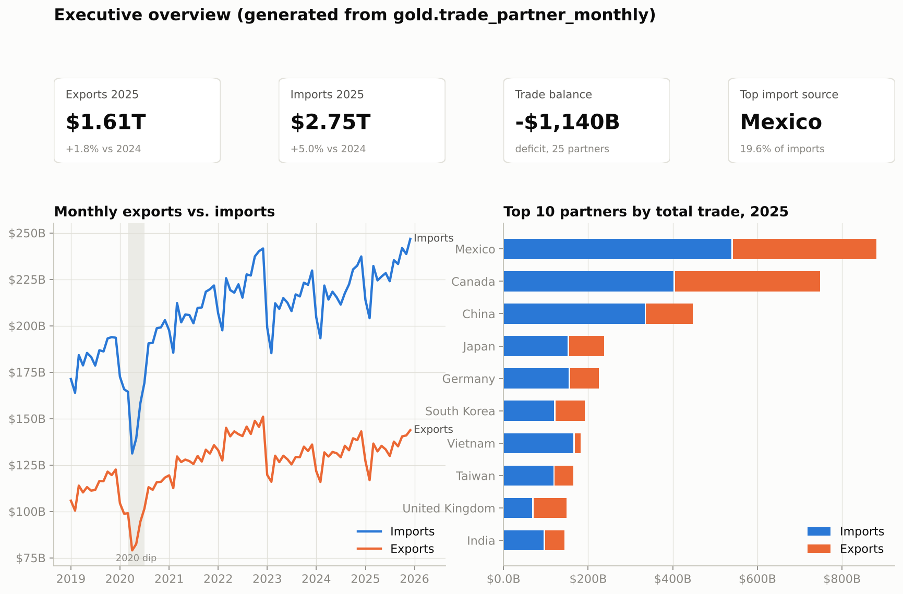
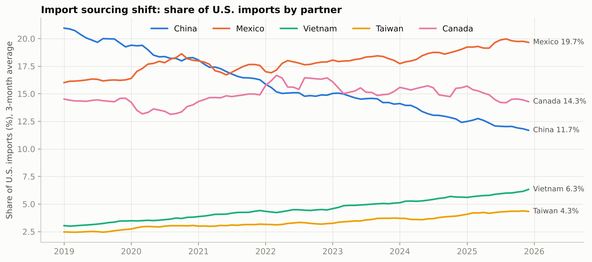
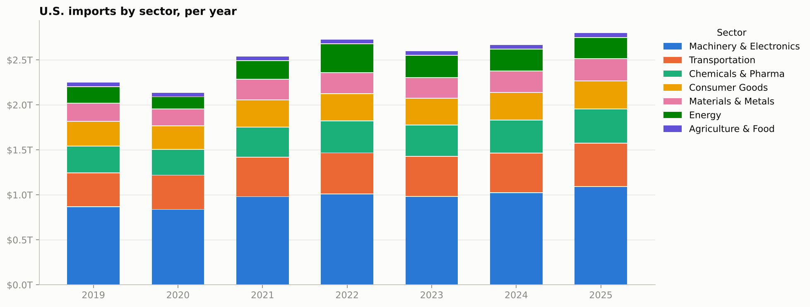
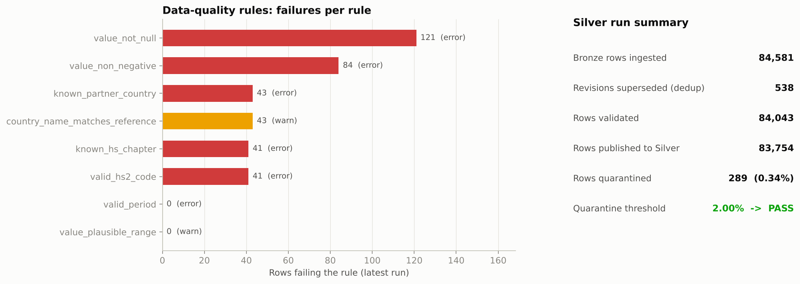
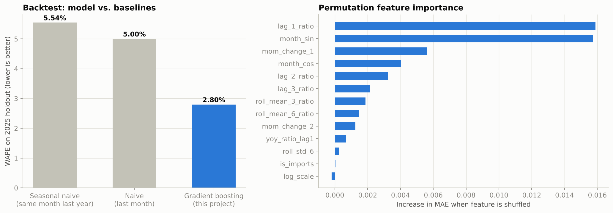
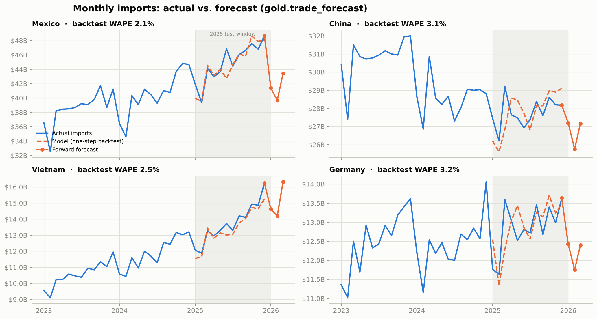
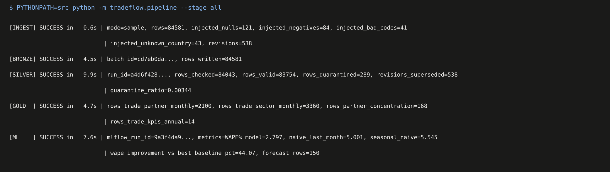

# 🌐 Global Trade Flow Lakehouse

**An end-to-end Databricks lakehouse for U.S. international trade data: incremental ingestion, Bronze/Silver/Gold Delta Lake pipeline, enforced data quality, Unity Catalog governance and an MLflow-tracked forecasting model, ready to feed Power BI.**


---

## 📌 The problem

Trade analysts need answers to questions like:

- *Which partners and sectors drive the U.S. trade deficit, and how is that changing?*
- *Is U.S. import sourcing shifting away from some countries toward others (e.g. China → Mexico, Vietnam)?*
- *What will imports from a given partner look like over the next quarter?*

The raw data comes from the U.S. Census Bureau as monthly files that are **revised after release**, use **cryptic codes** and occasionally arrive with **missing or invalid values**. This project turns that raw feed into **trusted, governed, analysis-ready tables** and a **forecast**, the way a production data platform would.

## 🏗️ Architecture



| Layer | What happens | Key techniques |
|---|---|---|
| **Ingest** | Monthly exports & imports by partner × HS2 chapter from the Census International Trade API land as NDJSON in a Unity Catalog **Volume** | Retry with backoff, incremental (skips months already landed) |
| **Bronze** | Raw files → append-only Delta table, all fields kept as strings | **Auto Loader** (`cloudFiles`, `availableNow`), lineage columns (`_source_file`, `_file_modified_at`, `_batch_id`) |
| **Silver** | Clean, type, **deduplicate revised records**, join reference dimensions, run **8 data-quality rules** | Window functions, broadcast joins, declarative expectations, quarantine table, fail-fast threshold |
| **Gold** | Business aggregates for BI and ML | Pivots, YoY via date self-join, partner concentration (**HHI**), annual KPIs |
| **ML** | Global gradient-boosting model forecasts 50 monthly series | Leakage-safe features, chronological backtest vs. baselines, **MLflow** tracking + **Unity Catalog model registry** |
| **Serve** | Power BI over a Databricks SQL Warehouse | 25+ **DAX** measures (time intelligence, ranking, concentration, forecast accuracy) |
| **Orchestrate** | One scheduled job runs every stage in order | **Databricks Asset Bundle** → Lakeflow Job on serverless compute, GitHub Actions CI |

## 📊 Results

> The images below were generated by `scripts/make_charts.py` from this pipeline's own Gold and ops tables, after running it in **sample mode** (see [Data source](#-data-source)).

### Executive overview


### Import sourcing shift
China's share of U.S. imports falls while Mexico and Vietnam rise, the "nearshoring / friend-shoring" pattern trade analysts track.



### Imports by sector


### Data quality: every bad record caught and explained
The sample feed contains deliberately corrupted records (nulls, negative values, malformed HS codes, unknown partner codes) and 538 revised re-sends. The pipeline **caught all 289 injected bad rows**, routed them to quarantine with the failing rule names, and kept only the latest version of each revised record.



### Forecasting: 44% lower error than the best baseline
On the 2025 holdout year (one month ahead, never trained on), the model's weighted error (WAPE) is **2.8%**, against **5.0%** for "same as last month" and **5.5%** for "same month last year".





### Pipeline run


---

## ⚙️ How it works

### 1. Ingestion (`src/tradeflow/ingestion/`)
- `census_api.py` calls `api.census.gov/data/timeseries/intltrade/{exports|imports}/hs` for each month at HS2 level, maps the endpoint-specific fields (`ALL_VAL_MO` vs `GEN_VAL_MO`, `E_COMMODITY` vs `I_COMMODITY`) to one shared layout, retries on 429/5xx with exponential backoff, and skips months that already have a landing file.
- `sample_generator.py` writes the same layout offline (for demos and CI).

### 2. Bronze (`bronze.py`)
- On Databricks: **Auto Loader** with `trigger(availableNow=True)` and a checkpoint in a Volume, so each run picks up only new files, exactly once.
- Nothing is cleaned or dropped. Every row keeps its source file and load time, so any number in Gold can be traced back to a raw file.

### 3. Silver (`silver.py`, `quality.py`)
1. **Standardise:** trim, upper-case, zero-pad HS codes, cast values, parse `YYYY-MM` to a date.
2. **Deduplicate revisions:** Census revises past months. A window over `(flow, period, country, commodity)` ordered by file modification time keeps only the newest version.
3. **Conform:** broadcast-join country (region, ISO3, trade agreement) and HS chapter (sector) reference tables.
4. **Validate:** rules are declared as SQL expressions with a severity:

| Rule | Severity | Check |
|---|---|---|
| `value_not_null` | error | value present |
| `value_non_negative` | error | value ≥ 0 |
| `valid_period` | error | parses as a month, not in the future |
| `valid_hs2_code` | error | two-digit HS chapter |
| `known_partner_country` | error | code exists in reference table |
| `known_hs_chapter` | error | chapter exists in reference table |
| `value_plausible_range` | warn | < $100B for one partner/chapter/month |
| `country_name_matches_reference` | warn | source name matches reference |

Error rows go to `silver.trade_flows_quarantine` with an array of the failed rules. Per-rule results are appended to `ops.dq_results` every run. **The job fails** if more than 2% of rows are quarantined, so bad data never reaches Gold silently.

### 4. Gold (`gold.py`)
- `trade_partner_monthly`: exports, imports, balance, YoY growth (via a self-join on `period − 12 months`, robust to missing months)
- `trade_sector_monthly`: value and share of each flow by sector and HS chapter
- `partner_concentration`: **Herfindahl-Hirschman Index** and top-5 share, showing whether sourcing is diversifying
- `trade_kpis_annual`: yearly totals, growth, top partner

### 5. Machine learning (`forecasting.py`)
- **One global model** for all 25 partners × 2 flows = 50 series.
- **Target:** `log(value_t / value_t−12)`, a scale-free seasonal ratio, so a $45B/month partner and a $1B/month partner share one model.
- **Features (no leakage):** recent ratios vs. last year, month-over-month momentum, rolling means and volatility, last YoY growth, month seasonality (sin/cos). A unit test proves that changing month *t* never changes month *t*'s features.
- **Validation:** chronological split, trained through Dec 2024 and tested one step ahead on all of 2025, compared with two standard baselines.
- **MLflow:** logs parameters, metrics, permutation feature importance and the model with its signature. On Databricks it registers `trade_lakehouse.ml.trade_forecaster` in **Unity Catalog** and sets the `@champion` alias.
- The final model is refit on all history and produces a 3-month **recursive forecast** written to `gold.trade_forecast`.

### 6. Governance with Unity Catalog (`sql/`)
- Catalog `trade_lakehouse` with `bronze`, `silver`, `gold`, `ml`, `ops` schemas and Volumes for raw files and checkpoints
- **Least-privilege grants:** engineers own all layers, analysts (and the Power BI service principal) read Gold only, data scientists read Silver/Gold and write models
- **Tags** (`layer`, `pii`, `certified`), table and column **comments**, a **row filter** that limits a regional analyst group to its own region
- Automatic **lineage** from Bronze → Silver → Gold in Catalog Explorer

### 7. Power BI (`powerbi/`)
[`measures.dax`](powerbi/measures.dax) defines a date table and 25+ measures: totals, `SAMEPERIODLASTYEAR` YoY, YTD, rolling averages, `RANKX` partner ranking, top-5 share, HHI concentration level, forecast WAPE. [`powerbi/README.md`](powerbi/README.md) explains how to connect to the SQL Warehouse and which pages to build.

---

## 📁 Repository structure

```
global-trade-flow-lakehouse/
├── conf/pipeline.yaml              # catalog, schemas, ingestion window, DQ threshold, ML settings
├── databricks.yml                  # Asset Bundle: scheduled Lakeflow Job (ingest → bronze → silver → gold → ml)
├── data/reference/                 # country + HS-chapter dimension CSVs
├── notebooks/                      # Databricks notebooks, one per stage
├── src/tradeflow/
│   ├── ingestion/census_api.py     # Census International Trade API client
│   ├── ingestion/sample_generator.py
│   ├── bronze.py  silver.py  gold.py
│   ├── quality.py                  # declarative data-quality rules
│   ├── forecasting.py              # features, model, backtest, MLflow
│   ├── pipeline.py                 # CLI entry point
│   └── config.py  io.py  spark_session.py
├── sql/                            # Unity Catalog setup, governance, analysis queries
├── powerbi/                        # DAX measures + report guide
├── scripts/make_charts.py          # renders the README figures from Gold tables
├── tests/                          # 13 pytest unit tests (Spark + pandas)
├── docs/                           # data dictionary, images
└── .github/workflows/ci.yml        # tests + end-to-end run on every push
```

## 🚀 Run it

### Option A: Databricks (Free Edition works)
1. Sign up for [Databricks Free Edition](https://www.databricks.com/learn/free-edition).
2. **Workspace → Create → Git folder** and paste this repo's URL.
3. Open a SQL editor and run `sql/00_unity_catalog_setup.sql` (skip the `GRANT` lines if you have no groups).
4. Run the notebooks in order `01` → `05` (use `mode = census_api` for real data or `sample` for the demo set), **or** deploy the whole job:
   ```bash
   databricks bundle deploy -t dev
   databricks bundle run trade_flow_pipeline -t dev
   ```
5. Run `sql/01_governance_tags_and_policies.sql`, then check **Catalog Explorer → Lineage**, the **Experiments** page for the MLflow run, and **Models** for the registered model.

### Option B: Locally (laptop or CI)
Requires Python 3.10+ and Java 17+.
```bash
pip install -r requirements.txt
export PYTHONPATH=src TRADEFLOW_TABLE_FORMAT=parquet   # use 'delta' if the Delta JARs can be downloaded
python -m tradeflow.pipeline --stage all               # ~30 seconds on sample data
python scripts/make_charts.py                          # regenerate docs/images
pytest -q
```
Use `TRADEFLOW_MODE=census_api` to pull real data from the Census API instead of the sample set.

## 🧪 Testing & CI
- **13 unit tests** cover rule routing and NULL handling, per-rule counts, cleaning and revision deduplication, YoY and balance math, HHI, feature leakage, metrics and the Census response parser (mocked HTTP).
- **GitHub Actions** runs the tests and a full end-to-end pipeline on every push, and validates the Databricks bundle when workspace credentials are configured.

## 🗂️ Data source
- **Live mode** (`census_api`): [U.S. Census Bureau International Trade API](https://www.census.gov/data/developers/data-sets/international-trade.html), monthly HS2 exports and imports by partner country.
- **Sample mode** (`sample`, default for demos and CI): a bundled generator writes data in exactly the same format. **The values are synthetic.** They are shaped to resemble real U.S. trade patterns (partner sizes, growth trends, a 2020 dip, a 2022 energy-price spike) and include deliberately corrupted records to exercise the quality layer. **They are not official statistics.** The results shown above come from sample mode.

## 🧠 Design decisions
- **Same landing format for every source**, so Bronze/Silver/Gold run identical code in live, sample and test modes.
- **Quarantine instead of silent drops**: every rejected row is kept with its reasons, which makes data issues auditable and fixable at the source.
- **Seasonal-ratio target + global model**: more data per parameter than 50 separate models, and robust to very different series sizes.
- **Baselines are mandatory**: a forecast is only useful if it beats "same as last month", so baseline metrics are logged next to the model's in every MLflow run.

## 🔭 Next steps
- Migrate Silver to **Lakeflow Declarative Pipelines** (`@dlt.expect_or_drop`) for managed expectations
- Add HS4/HS6 detail and ports of entry/exit
- Prediction intervals (quantile loss) and drift monitoring with **Lakehouse Monitoring**
- Join exchange-rate and tariff-schedule data as model features

---

**Author:** Tasfia Hasan · B.S. Computer Science, The City College of New York · [LinkedIn](https://linkedin.com/in/thasan263000) · [GitHub](https://github.com/thasan26)
